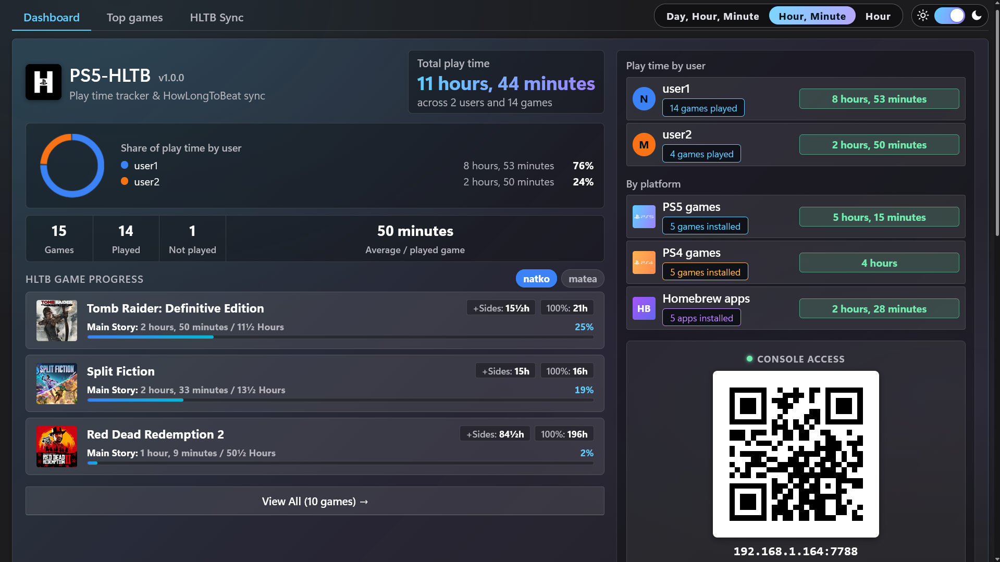
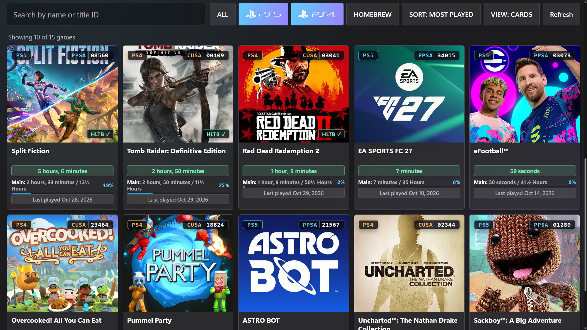
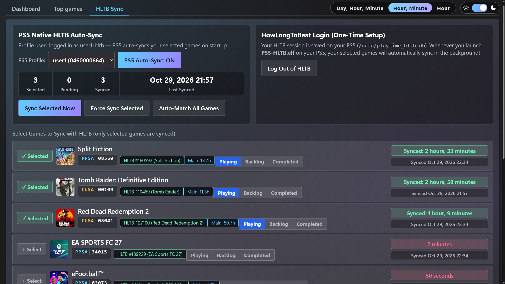
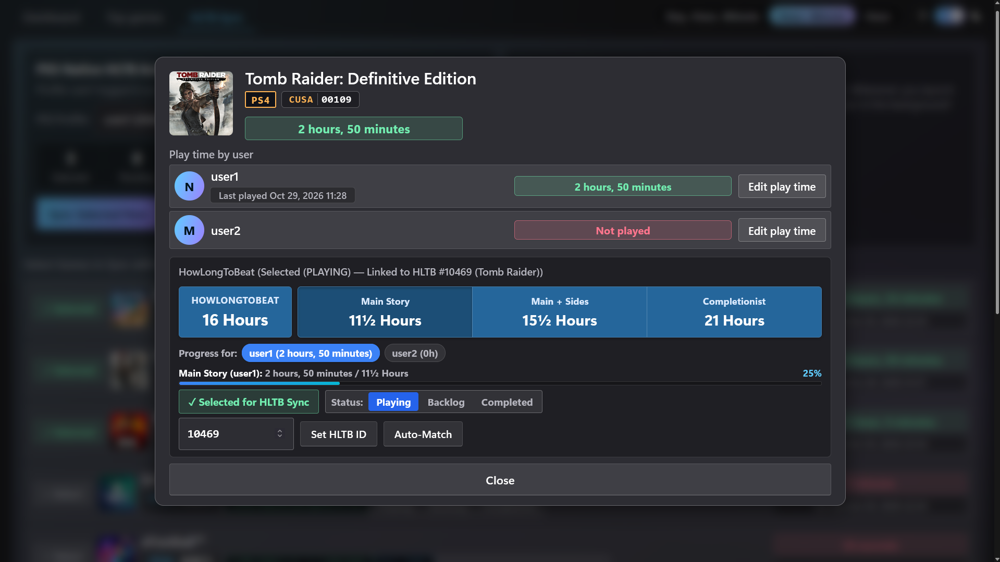

<p align="center">
  
</p>

# PS5-HLTB

A native PS5 ELF payload that tracks console play time, displays interactive stats and progress, and automatically syncs game completion times directly with **HowLongToBeat** (HLTB).

Open it on the console's own browser or from a phone / laptop on the same network via QR code.

> [!NOTE]
> This project is a fork of the original [PlayTime](https://github.com/ghost1372/PlayTime) payload by [Mahdi Hosseini](https://github.com/ghost1372), extended with native background HowLongToBeat (HLTB) synchronization, interactive completion progress tracking, multi-user / platform breakdowns, mobile optimization, and persistent settings.

## Requirements

- A PS5 payload loader that can run ELF payloads. PS5-HLTB works on all firmware versions your loader supports.
- The console and your phone / laptop must be on the same network if you want to open the web interface from another device.

> [!NOTE]
> Installed PS5 and PS4 games are listed (`PPSA` / `CUSA`). Homebrew apps are separated and excluded from HLTB sync.

## How to Use

1. Download the latest `PS5-HLTB-<version>.elf` (or `PS5-HLTB.elf`).
2. Send the ELF to your PS5 using [Payload Sender](https://github.com/ghost1372/payloadsender) or [payload manager](https://github.com/itsPLK/ps5-payload-manager).
3. The PS5 browser opens `http://127.0.0.1:7788` automatically.
4. From a phone or laptop on the same network, scan the **Phone QR** button or open `http://<ps5-ip>:7788`.

## Features

- **HowLongToBeat Integration**:
  - Direct native PS5 background syncing with your HLTB account via native HTTPS.
  - Independent per-profile logins and game selections for each console user.
  - Auto-matches games against HowLongToBeat's database with completion times (Main Story, Main + Sides, Completionist).
  - Track backlog, playing, and completed lists directly from the console.
- **Play Time Management**:
  - Total play time, games played / not played, average per played game.
  - Interactive user & platform playtime distribution charts and modals.
  - Search by name or title ID, multi-platform filter (PS5, PS4, Homebrew), persistent sort settings.
  - Dark and light themes.
  - Edit play time per user with backup (`/data/playtime_app.db.bak`).

## Screenshots

<p align="center">
  
</p>

<p align="center">
  
</p>

<p align="center">
  
</p>

<p align="center">
  
</p>

## How to compile

### Method 1: Using Docker (Recommended — Windows / macOS / Linux)

No local SDK installation is required; Docker compiles everything inside an isolated container using the included `Dockerfile.builder`:

1. Build the builder container image (one-time setup):
   ```sh
   docker build -t ps5-builder -f Dockerfile.builder .
   ```

2. Compile the payload:
   ```sh
   # On Windows (PowerShell):
   docker run --rm -v "${PWD}:/src" -w /src/src ps5-builder make clean all

   # On Linux / macOS:
   docker run --rm -v "$(pwd):/src" -w /src/src ps5-builder make clean all
   ```

### Method 2: Native Build (Linux / WSL2)

1. Clone and install the [PS5 Payload SDK](https://github.com/ps5-payload-dev/sdk):
   ```sh
   git clone --recurse-submodules https://github.com/ps5-payload-dev/sdk.git
   cd sdk
   make install DESTDIR=/opt/ps5-payload-sdk
   ```

2. Set the SDK environment variable:
   ```sh
   export PS5_PAYLOAD_SDK=/opt/ps5-payload-sdk
   ```

3. From the `src` directory, build the payload:
   ```sh
   cd src
   make clean all
   ```

The compiled output is `PS5-HLTB-v1.0.0.elf` (and `PS5-HLTB.elf`).

## Credits & Acknowledgments

- Forked from [ghost1372/PlayTime](https://github.com/ghost1372/PlayTime) by [Mahdi Hosseini](https://github.com/ghost1372).
- HowLongToBeat community data powered by [HowLongToBeat.com](https://howlongtobeat.com).
- **Development Note:** This fork was largely developed with AI assistance for C architecture, reverse-engineering HLTB requests, and modern web UI implementation, verified and tested on real PS5 hardware.
